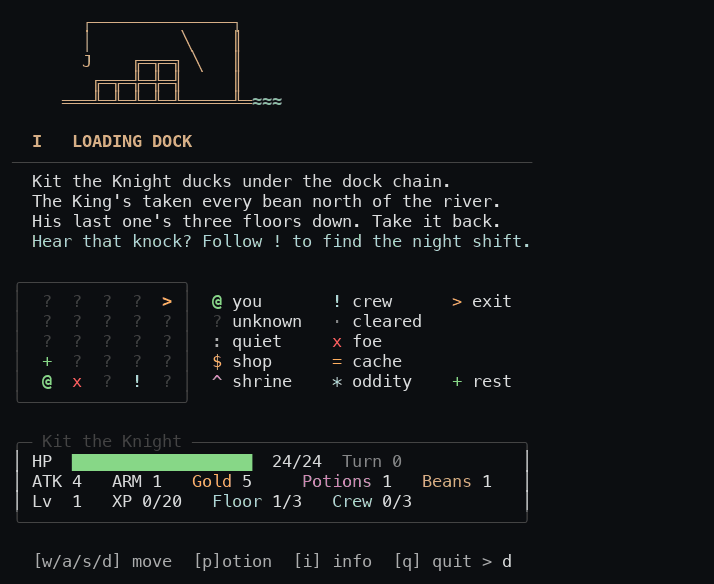

# Crypt of the Caffeinated King

The King has hoarded every bean north of the river. His night shift is still down there. Pick a calling, get the workers out if you can, and take the last bean off his kitchen counter.

A terminal dungeon crawler for Apple Silicon Macs. The game is written in AArch64 assembly and links against the system C library. The dungeon logic lives in `crypt.s` and the terminal artwork in `art.s`.

```sh
clang -o crypt crypt.s
./crypt
```

For a repeatable first run, try `./crypt --seed 18` as the Knight. Every run prints its seed. On the same version, a seed fixes each floor's layout even if you take a different route. Repeating the same choices also reproduces the fights and loot.



## The descent

| Floor | What to look for |
| --- | --- |
| **I · Loading Dock** | The dock has the most caches and two merchants. Somewhere in the side aisles, a porter is pinned under her cart. |
| **II · Boilerworks** | Trapped doorways are most common here. A fitter is knocking from the wrong side of a boiler door. Read the gauges before opening a valve. |
| **III · King's Pantry** | The King's guard is thickest here. Find the tasting hatch, or head for the throne. |

The map remembers what you could see from each doorway. A quiet room can still hide a trap. The crew's signal (`!`) and the exit (`>`) carry across the whole floor. You can come back to a worker, a shop, a shrine you passed up, or an unused campfire. A fountain waits if you reach it at full health. At the stairs, press Enter to descend or `b` to turn back. The workers you bring home change the ending.

## Fights

Read the next strike above the combat log. The number already includes your armor. Guard against a quick strike and half gets through, rounded up. Guard a wind-up and the blow misses entirely. Follow immediately with a heavy attack for a guaranteed double-damage riposte. Existing poison still ticks while you guard.

The King raises his cup with both hands every third turn. He also keeps a ristretto in reserve for when he falls to half health.

| Calling | Starting advantage |
| --- | --- |
| Knight | +4 max HP and +1 armor |
| Barista | Two extra potions. Each heals 15 HP instead of 10. |
| Rogue | +1 attack, a 15% critical chance on basic attacks, and a 75% chance to flee ordinary foes |

Eleven base monsters can pick up prefixes and suffixes that change their stats. An armored foe absorbs damage. A thief keeps stolen gold until you kill it. The regional manager can dock your attack for the rest of the fight, and insists you stay for the whole meeting.

Kills earn gold and XP. Each level adds 4 max HP and 1 attack. Merchants sell gear upgrades, beans, potions, and mystery boxes. Keep an eye out for the riddling owl and the dice goblin.

## Controls

Type a key and press Enter.

| Where | Keys |
| --- | --- |
| Exploring | `w` north, `a` west, `s` south, `d` east. Press `p` to drink a potion, `i` for the map and shift notes, or `q` to leave. |
| Fighting | `a` or Enter attacks. `h` makes a heavy attack (50% chance to hit before a foe's evasive trait) or takes an open riposte. `g` guards. |
| Fighting, supplies and escape | `b` chews a bean for +3 attack for the rest of the fight. `p` drinks a potion. Both spend the turn. `r` attempts to flee. |

Defeat and victory each tally a score from floor progress, level and gold, with another 500 points for beating the King. Your best score is saved in `~/.crypt-best`.

## Building and testing

Use Terminal.app or another UTF-8 terminal on an Apple Silicon Mac with the Xcode command line tools (`xcode-select --install`). The game uses ANSI color in an interactive terminal. Piped input and output work for scripted runs.

```sh
python3 tests/test_game.py -v
```

The tests compile the game in a temporary directory and drive it through its normal prompts with isolated scores. To tune the campaign, look for `floor_decks`, `monsters`, `prefixes`, `suffixes` and `specials` in `crypt.s`. Each floor deck has 22 ordinary rooms plus a separately placed crew landmark. Keep the roll counts in sync when adding entries to the monster and loot tables.
